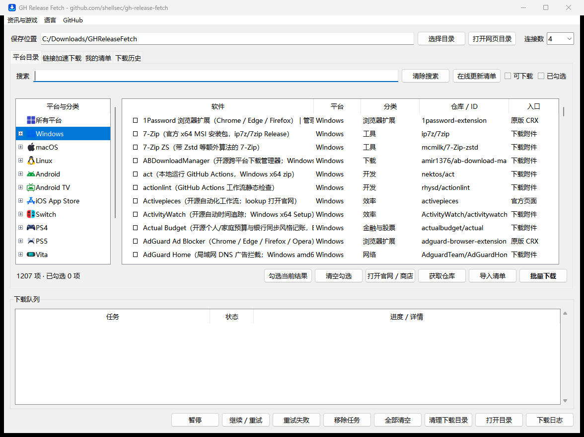

**Language / 语言:** [中文](README.md) | English

# GH Release Fetch

GH Release Fetch is a platform catalog and download manager for GitHub releases, direct links, source repositories, and Chrome extensions. The Windows desktop edition runs from one EXE with its catalogs and runtime bundled.

## Windows desktop app

Use **Check for app updates** to check the installed EXE. A newer build is installed only after approval and when the download queue is idle.



- Double-click `GHReleaseFetch.exe`. No separate Python installation is required.
- Use **Language → English** or **语言 → 简体中文**. The preference is saved. If a task or another window is open, restart the app to apply it.
- **Platform catalog** supports search, category browsing, and batch selection. **Accelerated downloads** accepts repositories, release assets, direct links, and Chrome Web Store links or IDs. GitHub downloads can test routes automatically, with parallel connections and resume support where the server allows it.
- **My lists** manages personal and custom entries. **Detect and import** extracts links from pasted text and previews entries before saving. **Download history** can download the original asset again or fetch the latest version when supported.
- Right-click a completed queue entry to open the downloaded file or its containing folder. Queue clearing, file cleanup, and log clearing are separate actions.
- Catalog updates run in the background on first launch and at seven-day intervals. You can also select **Update catalog**. Settings, personal lists, queue, history, logs, and cached catalogs are stored under `%LOCALAPPDATA%\GHReleaseFetch`.
- English applies to the desktop controls and dialogs. Catalog descriptions, upstream messages, and previous log entries keep their original language.


## Software directory website

The independent [`website/`](website/README.md) adds platform guides, curated tools, use-case collections, search, official download entry points and static-page SEO. It reuses the existing catalogs and supports GitHub Pages with a custom domain. The initial website content is in Simplified Chinese.

Preview locally: `python -m website.build`, then `python -m http.server 8080 --bind 127.0.0.1 --directory dist/site`.

## Downloads

Windows desktop release **20261114.3** · [Release notes](https://github.com/shellsec/gh-release-fetch/releases/tag/20261114.3)

| Host platform | Accelerated (gh-proxy.com) | GitHub direct |
| --- | --- | --- |
| Windows x64 | [EXE](https://gh-proxy.com/https://github.com/shellsec/gh-release-fetch/releases/download/20261114.3/GHReleaseFetch.exe) · [ZIP](https://gh-proxy.com/https://github.com/shellsec/gh-release-fetch/releases/download/20261114.3/gh-release-fetch-windows-20261114.3.zip) | [EXE](https://github.com/shellsec/gh-release-fetch/releases/download/20261114.3/GHReleaseFetch.exe) · [ZIP](https://github.com/shellsec/gh-release-fetch/releases/download/20261114.3/gh-release-fetch-windows-20261114.3.zip) · [SHA-256](https://github.com/shellsec/gh-release-fetch/releases/download/20261114.3/SHA256SUMS-20261114.3.txt) |
| macOS ARM64 / Apple Silicon | [tar.gz](https://gh-proxy.com/https://github.com/shellsec/gh-release-fetch/releases/download/20261028/gh-release-fetch-6bd1991-macos-arm64.tar.gz) | [tar.gz](https://github.com/shellsec/gh-release-fetch/releases/download/20261028/gh-release-fetch-6bd1991-macos-arm64.tar.gz) |
| Linux x86_64 | [tar.gz](https://gh-proxy.com/https://github.com/shellsec/gh-release-fetch/releases/download/20261028/gh-release-fetch-6bd1991-linux-x86_64.tar.gz) | [tar.gz](https://github.com/shellsec/gh-release-fetch/releases/download/20261028/gh-release-fetch-6bd1991-linux-x86_64.tar.gz) |
| Linux ARM64 | [tar.gz](https://gh-proxy.com/https://github.com/shellsec/gh-release-fetch/releases/download/20261028/gh-release-fetch-6bd1991-linux-arm64.tar.gz) | [tar.gz](https://github.com/shellsec/gh-release-fetch/releases/download/20261028/gh-release-fetch-6bd1991-linux-arm64.tar.gz) |
| macOS / Linux SHA256SUMS | [Checksums](https://gh-proxy.com/https://github.com/shellsec/gh-release-fetch/releases/download/20261028/SHA256SUMS) | [Checksums](https://github.com/shellsec/gh-release-fetch/releases/download/20261028/SHA256SUMS) |

The macOS and Linux packages use source revision `6bd1991` and bundle their runtime; no separate Python installation is needed. Use the direct link if the accelerator is unavailable. The macOS package is unsigned and not notarized. Linux requires glibc, does not support Alpine/musl, and has not been tested on a Linux machine. See the release notes for validation details.

## Quick start

1. Download the package for the **computer running this tool**. Extract the complete archive, keeping its catalog and data directories.
2. On Windows, open `GHReleaseFetch.exe`. For the legacy CLI in a source checkout, use `lookup_app.bat`. On macOS/Linux, run `./lookup_app` from the extracted directory.
3. Select the platform to search, then enter a name or keyword. Enter defaults to Windows; the last menu option searches all catalogs.
4. Select result numbers, then choose an action.

| Action | Behavior |
| --- | --- |
| 1: Download once | Download, or open the page if no package is available |
| 2 or Enter: Save and download | Save downloadable entries to the update list and download now |
| 3: Save to list | Add to the update list for later |
| 4: Enable | Set `enabled=true` for batch processing in that catalog |
| 5: Open page | Open the website or GitHub Releases page |

Enter `1,3` for multiple results, `a` for all, or Enter to skip. Some entries open a website, store, or release page instead of downloading an asset. Downloading for another platform does not make that software runnable on your computer.

### Repository downloads (menu 15)

Paste `owner/repo` or a GitHub URL, then choose a release asset, source ZIP, or Git clone. Saved updates move to menu 16. Source downloads resolve branches/tags to a commit, validate ZIP integrity, and optionally extract safely. Release assets use GitHub SHA256 digests when available.

ZIP/assets offer eight candidate routes including direct, bounded target-file speed probes, automatic failover, up to eight connections, and resumption guarded by a strong ETag and matching size. Unsupported ranges fall back to a single stream. Changing routes restarts the data to prevent mixed content. Candidate availability is checked at runtime.

Git uses the official remote and installed Git, with full/shallow history, optional submodules and LFS. ZIP snapshots do not contain Git history, submodule contents or LFS objects. Enter `h` at the repository prompt for history, retries, fresh snapshots and clean-worktree Git updates (`pull --ff-only`). Completed projects can open in a file manager, terminal or detected VS Code/VSCodium; README viewing does not run project code.

```text
python lookup_app.py --repository owner/repo
python lookup_app.py --repository owner/repo --repo-kind source --ref main --extract --no-prompt
python lookup_app.py --repository owner/repo --repo-kind git --shallow --no-prompt
```

Default output and task history live in `repository_downloads/`. `--output` selects the complete file/directory path; existing targets are never overwritten. Resume with the same version, destination and route. `--route direct`, `--threads 1|2|4|8`, `--submodules`, `--lfs`, and offline `--dry-run` are available. Public GitHub repositories are supported; metadata requests go directly to GitHub.

### Example session

Search for UniClipboard on Windows using a partial name. The interface is in Chinese; this abbreviated transcript adds English explanations and omits timestamps and network logs. Versions and result counts may change.

```text
lookup_app
Select catalog: 1 (Windows)
Keyword: unicli

2 matches:
[1] windows  id=uniclipboard      enabled=no  [downloadable]
[2] windows  id=uniclipboard_cli  enabled=no  [downloadable]

Select entries: 1
Select action: 1 (download now)

[Download] windows: uniclipboard
Latest version: v1.5.0
Progress: 100.0% (25.1/25.1 MiB)
Saved: <program directory>/windows/UniClipboard_1.5.0_x64-setup.exe
Installer started
```

This entry has `run_installer` enabled, so its installer starts after downloading. Other entries follow their own settings. Action 1 does not change `enabled`; disabled entries can still be downloaded explicitly.

Shortcuts on Windows:

```bat
lookup_app.bat -y --download drawio
lookup_app.bat chatbox --open
lookup_ios.bat 微信
```

## Platform catalogs

The tool runs on Windows, macOS, and Linux. The **catalog platform** describes the software or device you are searching for; it can differ from the host platform.

| Catalog | Directory | CLI platform |
| --- | --- | --- |
| Windows | `apps/windows/` | `windows` |
| macOS | `apps/darwin/` | `darwin` |
| Linux | `apps/linux/` | `linux` |
| Android | `apps-mobile/` | `android` |
| Android TV | `apps-tv/` | `android_tv` |
| iOS App Store | `apps-mobile/` | `ios` |
| Switch | `apps-switch/` | `switch` |
| PS4 | `apps-ps4/` | `ps4` |
| PS5 | `apps-ps5/` | `ps5` |
| Vita | `apps-vita/` | `vita` |
| Xbox | `apps-xbox/` | `xbox` |
| Linux handheld | `apps-handheld/` | `linux_handheld` |
| Custom catalog | `apps-custom/` | Manage with `--custom` |
| All catalogs | 上述平台及Custom catalog | `--all-catalogs` |

Windows examples:

```bat
lookup_app.bat drawio
lookup_mobile.bat termux
lookup_app.bat --apps-dir apps-tv --platform android_tv music
lookup_app.bat --apps-dir apps-handheld --platform linux_handheld proton
lookup_app.bat --all-catalogs music
```

On macOS/Linux, replace `lookup_app.bat` with `./lookup_app`. Specify the platform when passing keywords, or use the menu with no arguments. Check each upstream project for console firmware, device architecture, and installation requirements.

Browse: [Desktop](CATALOG.md) · [Mobile](CATALOG.mobile.md) · [Switch](CATALOG.switch.md) · [PS5](CATALOG.ps5.md) · [Category page](catalog.html).

## Custom catalog

Choose the custom catalog in the main menu, or run `lookup_app.bat --custom` (`./lookup_app --custom` on macOS/Linux).

Adding an entry follows: **source → detect assets → select platform, architecture, and package type → preview → save or save and download**.

Accepted sources include `owner/repo`, GitHub repository or Release URLs, and HTTP(S) download links. A software name can also be used to find candidate projects. You can select multiple assets from one project. Confirm whether an APK targets Android phones or Android TV; select the platform manually for ambiguous archives.

- GitHub entries follow the latest stable Release using the selected asset rules. If names change, identify the assets again.
- Direct URLs remain fixed links without automatic version detection. Adding an entry does not launch its installer.
- Search, rename, categorize, identify assets again, delete, add in batches, and import/export JSON.
- Changes create backups, keeping up to 20 revisions for undo. Removing an entry does not delete downloaded files.
- Platform, architecture, and portable/installer preferences are remembered after a successful addition and can be changed or cleared.

Personal entries, preferences, and history live in `apps-custom/`. Release packages include an empty template. Use export to share your list.

```bat
lookup_app.bat --custom-add https://github.com/shellsec/bolemusic
lookup_app.bat --custom-add https://example.org/app.exe --dry-run
```

## Update lists and batch downloads

Search actions 2 and 3 save entries to `saved_apps_<platform>.json`. Open **Saved update lists** from the search menu or run `run_saved_apps --manage`. Select a list to view or remove entries. Press `a` to download the current list or all lists from the main menu. Press `i` to select past successful downloads to import from `update_log.txt`.

Batch downloads go into a new folder under `batch_downloads`, grouped by platform. The tool opens the batch folder once at the end. Run installers or extract portable archives yourself. See `update_log.txt` for download results.

Without application IDs, `auto_update` only processes enabled entries in the selected catalog. **Explicit IDs do not require `enabled=true`.** Start with the search entry point if you have no saved list or enabled entries.

Each catalog's `root.json` controls the download directory and related settings. Installer execution depends on the entry's `run_installer` setting; archives are not extracted automatically. Review the selected entries before batch processing.

## Web-page and game-channel searches

Use `search_soft_pages.bat` for software articles and `search_games.bat` for game-channel pages. Both can invoke the CLI in `GHReleaseFetch.exe` and are also available as menu options 17 and 18. On macOS/Linux, use `./search_soft_pages` and `./search_games`.

These separate page indexes primarily open links. They are outside the main menu's all-catalog search. See the [channel tools guide](tools/soft_page_check/README.md) for index refresh and monitoring.

## Troubleshooting

| Issue | What to check |
| --- | --- |
| Windows reports a `CATALOGS` import error | Replace the old executables with the current release. Bundled modules are isolated from old adjacent `tools/*.py` files. Keep personal catalogs and settings. |
| Catalogs are missing after copying one executable | Use the current single EXE. Legacy packages with adjacent data folders should be extracted in full. |
| No saved list or enabled apps | Search with `lookup_app`, then save entries to a list or enable them. |
| Download fails or no asset matches | Check the upstream release page, network, and asset rules. Some entries only provide a page link. |
| Slow download or unavailable accelerator | Try the GitHub direct link. Application downloads also try fallback sources according to configuration. |
| macOS cannot verify the developer | The package is unsigned and not notarized. Verify its source and follow the system's security settings. |
| Linux cannot run the package | Check CPU architecture and glibc availability; Alpine/musl is unsupported. |
| More error details needed | Run from a terminal. Download logs use `update_log.txt`; unexpected startup errors use `startup_error.log`. If the directory is unwritable, inspect console output. |

Catalog coverage is limited, and upstream changes can break existing entries. Add custom sources or update the relevant matching rules as needed.

## Run from source and build

Source execution requires Python 3.10 or newer. Release-package users can skip these steps.

```bash
git clone https://github.com/shellsec/gh-release-fetch.git
cd gh-release-fetch
python -m pip install -r requirements.txt
python lookup_app.py
```

Common commands:

```bash
python lookup_app.py --platform windows --no-prompt drawio
python lookup_app.py --all-catalogs --no-prompt music
python auto_update.py --platform windows drawio
python tools/run_saved_apps.py --help
```

On Windows, run `pack_windows_release.bat`; output is written to `dist/release/`. See [Windows packaging](release/windows/PACKAGING.md). Current macOS/Linux packages use a portable directory with bundled CPython; keep the runtime directory intact.

See the [configuration and maintenance reference](docs/reference.en.md) for fields, mirrors, download paths, logs, and maintenance scripts. Desktop global settings are in [apps/root.json](apps/root.json). Application IDs must be unique within each platform's JSON shards.


## Repository layout

`windows_gui.py` is the desktop entry point. `lookup_app.py` and `auto_update.py` provide the CLI and download workflows. Shared code is in `tools/`, platform catalogs are in `apps*/`, and the static directory site is in `website/`. Tests are in `tests/`; packaging scripts and assets are in `tools/` and `release/windows/`.

On Windows, run `python windows_gui.py` to start the GUI from source. Run `powershell -ExecutionPolicy Bypass -File tools/build_exe.ps1` to build `dist/exe/GHReleaseFetch.exe`. Build output, dependencies, and local logs belong outside version control.

## Related projects and support

[AI tools directory: aiv123.com](https://aiv123.com/) · [ofox.ai](https://ofox.io/x/aiv123) · [Buy me a Coke / Afdian](https://ifdian.net/a/shellsec)

Optional independent catalogs: [VibeCodingToolsDown](VibeCodingToolsDown/README.md) · [GiteeExploreHot](GiteeExploreHot/README.md). These are outside the main menu's all-catalog search.
