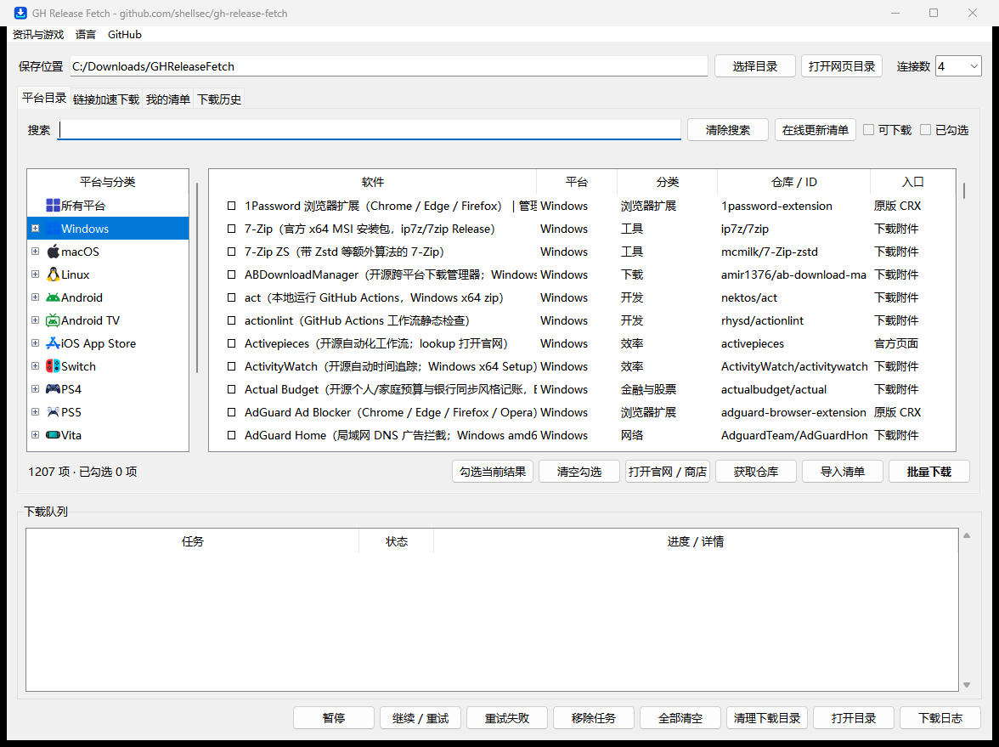

**语言 / Language:** 中文 | [English](README.en.md)

# GH Release Fetch

GH Release Fetch 是按平台浏览和下载软件的工具，支持 GitHub Release、直链、源码仓库和 Chrome 扩展。Windows 桌面版只需一个 EXE，内置清单和运行环境。

## Windows 桌面版

顶部「检查程序更新」检查 EXE 新版。确认下载后，程序会校验文件并等待下载队列空闲，再替换并重启。



- 双击 `GHReleaseFetch.exe` 即可使用，无需另装 Python。
- 在菜单选择 **语言 → 简体中文** 或 **Language → English**。偏好会保存。下载或后台任务进行中、或有其他窗口打开时，重启后生效。
- **平台目录**支持分类浏览、搜索和勾选批量下载。**链接加速下载**支持 GitHub 仓库、发布附件、直链和 Chrome 商店链接或 ID。GitHub 下载可自动测速选线路，服务器支持时可使用多线程和断点续传。
- **我的清单**管理个人和自定义条目。「一键识别导入」可从粘贴的文字提取链接，预览后入库。**下载历史**支持重下原附件或获取最新版，具体取决于来源。
- 下载完成后可在队列右键直接打开文件或打开所在目录。清空队列、清理下载文件和清空日志各有独立入口。
- 首次启动和之后每隔七天后台检查目录更新，也可点「在线更新清单」。设置、个人清单、队列、历史、日志和目录缓存保存在 `%LOCALAPPDATA%\GHReleaseFetch`。
- 英文适用于桌面控件和对话框。软件目录简介、上游报错和已有日志保留原文。


## 软件导航网站

新增独立的 [`website/`](website/README.md)：按平台、用途与场景浏览精选工具，支持搜索、官方获取入口及静态页面 SEO。与本地下载器共用软件清单，可部署 GitHub Pages 并绑定子域名。

本地预览：`python -m website.build`，再运行 `python -m http.server 8080 --bind 127.0.0.1 --directory dist/site`。

## 下载与加速下载

Windows 桌面版 **20261114.3** · [版本说明](https://github.com/shellsec/gh-release-fetch/releases/tag/20261114.3)

| 运行平台 | 加速下载（gh-proxy.com） | GitHub 原始下载 |
| --- | --- | --- |
| Windows x64 | [EXE](https://gh-proxy.com/https://github.com/shellsec/gh-release-fetch/releases/download/20261114.3/GHReleaseFetch.exe) · [ZIP](https://gh-proxy.com/https://github.com/shellsec/gh-release-fetch/releases/download/20261114.3/gh-release-fetch-windows-20261114.3.zip) | [EXE](https://github.com/shellsec/gh-release-fetch/releases/download/20261114.3/GHReleaseFetch.exe) · [ZIP](https://github.com/shellsec/gh-release-fetch/releases/download/20261114.3/gh-release-fetch-windows-20261114.3.zip) · [SHA-256](https://github.com/shellsec/gh-release-fetch/releases/download/20261114.3/SHA256SUMS-20261114.3.txt) |
| macOS ARM64 / Apple Silicon | [tar.gz](https://gh-proxy.com/https://github.com/shellsec/gh-release-fetch/releases/download/20261028/gh-release-fetch-6bd1991-macos-arm64.tar.gz) | [tar.gz](https://github.com/shellsec/gh-release-fetch/releases/download/20261028/gh-release-fetch-6bd1991-macos-arm64.tar.gz) |
| Linux x86_64 | [tar.gz](https://gh-proxy.com/https://github.com/shellsec/gh-release-fetch/releases/download/20261028/gh-release-fetch-6bd1991-linux-x86_64.tar.gz) | [tar.gz](https://github.com/shellsec/gh-release-fetch/releases/download/20261028/gh-release-fetch-6bd1991-linux-x86_64.tar.gz) |
| Linux ARM64 | [tar.gz](https://gh-proxy.com/https://github.com/shellsec/gh-release-fetch/releases/download/20261028/gh-release-fetch-6bd1991-linux-arm64.tar.gz) | [tar.gz](https://github.com/shellsec/gh-release-fetch/releases/download/20261028/gh-release-fetch-6bd1991-linux-arm64.tar.gz) |
| macOS / Linux SHA256SUMS | [校验文件](https://gh-proxy.com/https://github.com/shellsec/gh-release-fetch/releases/download/20261028/SHA256SUMS) | [校验文件](https://github.com/shellsec/gh-release-fetch/releases/download/20261028/SHA256SUMS) |

macOS 和 Linux 安装包基于 `6bd1991`，自带运行环境，无需另装 Python。加速入口不可用时，请使用原始下载。macOS 包未签名或公证；Linux 需要 glibc，不适用于 Alpine/musl，尚未实机验证。具体测试范围见版本说明。

## 快速开始

1. 下载适合**运行这套工具的电脑**的安装包，完整解压，保留包内清单和数据目录。
2. Windows 双击 `GHReleaseFetch.exe`。使用源码目录里的旧批处理入口时，可运行 `lookup_app.bat`。macOS/Linux 在解压目录执行 `./lookup_app`。
3. 选择要搜索的平台，输入软件名或关键词。回车默认 Windows，最后一项可搜索全部清单。
4. 选择结果序号，再选择下载、加入更新列表或启用。

| 操作 | 用途 |
| --- | --- |
| 1：仅下载一次 | 获取所选软件，无合适安装包时打开页面 |
| 2 或回车：加入并下载 | 保存可下载条目到更新列表，并立即下载 |
| 3：只加入 | 保存到更新列表，稍后统一下载 |
| 4：启用 | 设置 `enabled=true`，参与对应清单的批量处理 |
| 5：打开页面 | 打开官网或 GitHub Releases 页面 |

多选可输入 `1,3`，`a` 选全部，回车跳过。部分条目提供官网、商店或发布页入口，无法直接下载安装包。跨平台下载不会让目标软件在当前电脑上运行。

### 仓库下载（菜单 15）

同一入口也接受 Chrome 网上应用店扩展详情链接或 32 位扩展 ID。可打开商店安装，也可从 Google 下载原版 `.crx`，默认保存到 `extension_downloads/`。Google 支持分段时使用多连接，续传使用同一扩展 ID、保存路径和连接数。

菜单 15 输入 `V` 可按用途浏览 GitHub 开源 Chrome 扩展或 Chrome 商店扩展。GitHub 条目可获取发布包、源码 ZIP 或 Git 克隆，商店条目可下载原版 CRX。普通 GitHub 仓库仍可在菜单 15 直接输入地址。

网页批量下载时，Windows 双击 `open_catalog.bat`，macOS 和 Linux 运行 `python lookup_app.py --serve-catalog`。保持启动窗口开启，在网页勾选多个条目并点击「批量下载」。附件保存到 `catalog_downloads/` 下对应的平台目录，Chrome 扩展保存到 `catalog_downloads/chrome/`。标为「加入清单（打开页面）」的条目会打开官方页面。直接打开静态 `catalog.html` 时可复制清单到菜单 15。

`python lookup_app.py --repository cnjifjpddelmedmihgijeibhnjfabmlf --no-prompt --threads 4`

输入 `owner/repo` 或 GitHub 地址，在同一入口选择发布包、源码 ZIP、Git 克隆。支持指定分支 / 标签 / 提交，个人更新清单顺延到 16。

ZIP / 附件下载提供 8 条候选线路自动测速、手动选线、最多 8 连接、强 ETag 断点续传和失败换线。不支持分段时自动单连接；换线重新下载，避免分片混拼。源码 ZIP 固定 commit 并检查压缩包完整性，可安全解压；Release 有官方 SHA256 时核对摘要。Git 支持完整 / 浅历史、子模块和 LFS，使用官方远程。

```text
python lookup_app.py --repository owner/repo
python lookup_app.py --repository owner/repo --repo-kind source --ref main --extract --no-prompt
python lookup_app.py --repository owner/repo --repo-kind git --shallow --no-prompt
```

仓库输入处按 `h` 查看任务、继续 ZIP 下载、获取最新快照或安全更新 Git（只允许无本地改动且来源一致的工作区，采用 `--ff-only`）。完成后可打开目录、编辑器、终端或 README。默认下载至 `repository_downloads/`；已有目标拒绝覆盖。源码快照不包含 Git 历史、子模块及 LFS 实际内容。更多参数和续传条件见 [中文说明](README.zh-CN.md#仓库下载菜单-15)。

### 实际操作示例

以 Windows 搜索 UniClipboard 为例，输入部分名称也能匹配。以下省略完整时间戳、网络探测和下载地址，仅展示操作过程；版本号和结果数量以实际运行为准。

```text
用法: lookup_app [选项与关键词...]
示例: lookup_app drawio
      lookup_mobile.bat termux
      lookup_ios.bat 微信
直接下载: lookup_app -y --download drawio
打开页面: lookup_app chatbox --open

搜哪个清单?
  1 Windows       2 macOS          3 Linux
  4 Android       5 Android TV     6 iOS App Store
  7 Switch        8 PS4            9 PS5
 10 Vita         11 Xbox          12 Linux掌机
 13 自定义清单   14 搜全部清单
 15 仓库与 Chrome 扩展下载  16 个人更新清单
 17 软件资讯搜索  18 游戏页面搜索
请选择 (1-18，回车=Windows，q=退出): 1
请输入关键词（回车=返回清单）: unicli

共 2 条匹配：
[1] windows  id=uniclipboard      enabled=否  [可下载]
    简介: UniClipboard（跨平台剪贴板同步与管理，Rust + Tauri）
[2] windows  id=uniclipboard_cli  enabled=否  [可下载]
    简介: UniClipboard CLI（Windows x64 zip）

请选择要操作的条目：
  输入序号（如 1 或 1,3）| a=全部 | b/回车=返回 | q=退出
> 1

请选择操作：
  1 = 立刻下载（无安装包则打开页面；不修改 enabled）
  2 = 加入更新列表并立刻下载
  3 = 加入更新列表 saved_apps_<平台>.json
  4 = 设为 enabled=true
  5 = 打开页面（官网 / GitHub Releases）
  回车 = 加入并下载    b = 返回    q = 退出
> 1

[下载] 平台 windows：uniclipboard
找到最新版本: v1.5.0
下载进度: 100.0% (25.1/25.1 MiB)
安装包已下载: <程序目录>/windows/UniClipboard_1.5.0_x64-setup.exe
安装程序已启动
```

菜单 1–12 选定平台后，在关键词提示输入 `V` 可以按分类浏览。输入多个序号（如 `1,3,5`）或 `a` 全选当前分类，附件保存到 `catalog_downloads/`，页面条目会打开官方入口。

此示例条目配置了 `run_installer`，所以下载后启动安装程序；其它条目是否启动取决于各自配置。操作 1 不修改 `enabled`，即使结果显示“未启用”也能直接下载。

## 按平台搜索

工具的运行平台是 Windows、macOS、Linux；**清单平台**是要查找的软件或设备类型，两者可以不同。

| 菜单分类 | 清单目录 | 命令行平台值 |
| --- | --- | --- |
| Windows | `apps/windows/` | `windows` |
| macOS | `apps/darwin/` | `darwin` |
| Linux | `apps/linux/` | `linux` |
| Android | `apps-mobile/` | `android` |
| Android TV | `apps-tv/` | `android_tv` |
| iOS App Store | `apps-mobile/` | `ios` |
| Switch | `apps-switch/` | `switch` |
| PS4 | `apps-ps4/` | `ps4` |
| PS5 | `apps-ps5/` | `ps5` |
| Vita | `apps-vita/` | `vita` |
| Xbox | `apps-xbox/` | `xbox` |
| Linux 掌机 | `apps-handheld/` | `linux_handheld` |
| 自定义清单 | `apps-custom/` | 通过 `--custom` 管理 |
| 搜全部清单 | 上述平台及自定义清单 | `--all-catalogs` |

Windows 示例：

```bat
lookup_app.bat drawio
lookup_mobile.bat termux
lookup_app.bat --apps-dir apps-tv --platform android_tv 洛雪
lookup_app.bat --apps-dir apps-handheld --platform linux_handheld proton
lookup_app.bat --all-catalogs music
```

macOS/Linux 使用 `./lookup_app` 替换示例中的 `lookup_app.bat`。带关键词时可显式指定平台；无参数运行可从菜单选择。主机和掌机条目的固件、架构及安装要求以项目说明为准。

浏览清单：[桌面](CATALOG.md) · [移动端](CATALOG.mobile.md) · [Switch](CATALOG.switch.md) · [PS5](CATALOG.ps5.md) · [分类展示页](catalog.html)。

## 自定义清单

主菜单选择「自定义清单」，或运行 `lookup_app.bat --custom`（macOS/Linux：`./lookup_app --custom`）。

添加流程：**输入来源 → 识别附件 → 选择平台/架构/包类型 → 预览 → 仅保存或保存并下载**。

支持 `owner/repo`、GitHub 仓库或 Release 地址、HTTP(S) 下载直链，也可输入软件名查找候选项目。同一项目可选择多个附件；普通 APK 需确认 Android 手机或 Android TV，无法判断的压缩包需手动选择平台。

- GitHub 条目按所选附件规则跟随最新稳定 Release；命名变化时需重新识别附件。
- 普通直链按固定链接保存，不自动判断新版本。添加操作不会自动运行安装包。
- 支持搜索、修改名称/分类、重新识别、删除、批量添加、JSON 导入导出。
- 变更前自动备份，最多保留 20 次，可撤销最近修改；删除条目不会删除下载文件。
- 平台、架构和绿色版/安装版偏好会在成功添加后记住，可修改或清除。

个人条目、偏好和历史保存在 `apps-custom/`，发布包只附空模板。分享前请使用导出功能。

```bat
lookup_app.bat --custom-add https://github.com/shellsec/bolemusic
lookup_app.bat --custom-add https://example.org/app.exe --dry-run
```

## 更新列表与批量下载

搜索后按回车或选择操作 2，会按平台保存 `saved_apps_<平台>.json` 并下载。只想先加入，选 3。

在搜索主菜单进入「个人更新清单」，输入序号查看和移除条目，按 `a` 下载当前清单或所有清单。也可以运行 `lookup_app --manage-saved` 或 `run_saved_apps --manage`。按 `i` 可从 `update_log.txt` 导入能匹配到目录的成功下载记录，预览后输入序号或 `a` 全选。

在管理菜单批量下载后，工具会打开一次 `batch_downloads` 下的本次目录，文件按平台存放。安装包需手动运行，便携包需手动解压替换。下载结果和失败原因可查 `update_log.txt`。

`auto_update` 不带应用 ID 时，只处理对应清单中 `enabled: true` 的条目；**明确指定 ID 时不要求启用**。首次使用建议从搜索入口开始。

下载位置由各清单 `root.json` 的 `download_dir` 等设置决定。安装包是否运行取决于条目的 `run_installer`；压缩包不会自动解压。批量处理前先检查所选条目的下载与安装设置。

## 介绍页与游戏频道搜索

`search_soft_pages.bat` 搜索介绍页标题，`search_games.bat` 搜索游戏频道。两者可调用统一的 `GHReleaseFetch.exe` 命令行入口，也可从主菜单选 17 或 18。macOS/Linux 对应入口为 `./search_soft_pages` 和 `./search_games`。

这些是独立的页面索引，结果以打开链接为主，不属于「搜全部清单」的 GitHub 软件条目。索引刷新和监控见 [频道工具说明](tools/soft_page_check/README.md)。

## 常见问题

| 问题 | 处理方式 |
| --- | --- |
| Windows 启动时报 `CATALOGS` 导入错误 | 使用本页最新修复包，覆盖旧 EXE。新版内置模块不会被旁边的旧 `tools/*.py` 覆盖，可保留个人清单和配置。 |
| 只复制一个 EXE 后找不到清单 | 新版使用单 EXE。旧版发布包请完整解压并保留同级数据目录。 |
| 没有更新列表或启用项 | 先运行 `lookup_app` 搜索，选择加入列表或启用，再运行批量入口。 |
| 下载失败、无合适附件 | 查看项目发布页、网络和附件命名规则；部分收录条目仅提供页面入口。 |
| 下载慢或加速入口不可用 | 尝试 GitHub 原始链接；应用下载也会按配置尝试备用来源。 |
| macOS 提示无法验证开发者 | 当前包未签名或公证；确认来源后，按系统安全设置提示处理。 |
| Linux 无法运行 | 确认 CPU 架构和 glibc 环境；此包不适用于 Alpine/musl。 |
| 想查看错误详情 | 在终端运行入口，查看程序目录的 `update_log.txt`；意外启动异常另写 `startup_error.log`，目录不可写时查看控制台输出。 |

清单并不包含所有软件，已收录项目也可能因上游变更失效。可通过自定义清单补充来源，或维护对应条目的匹配规则。

## 从源码运行与打包

源码使用 Python 3.10 或更新版本。发布包用户无需执行以下步骤。

```bash
git clone https://github.com/shellsec/gh-release-fetch.git
cd gh-release-fetch
python -m pip install -r requirements.txt
python lookup_app.py
```

常用命令：

```bash
python lookup_app.py --platform windows --no-prompt drawio
python lookup_app.py --all-catalogs --no-prompt music
python auto_update.py --platform windows drawio
python tools/run_saved_apps.py --help
```

Windows 打包运行 `pack_windows_release.bat`，输出位于 `dist/release/`。详见 [Windows 打包说明](release/windows/PACKAGING.md)。macOS/Linux 当前发布包采用自带 CPython 的便携目录格式，需完整保留运行时目录。

配置字段、镜像回退、下载目录、日志及维护脚本见 [配置与维护参考](docs/reference.zh-CN.md)。桌面全局配置见 [apps/root.json](apps/root.json)，同平台各 JSON 分片的应用 `id` 不可重复。


## 仓库结构

`windows_gui.py` 是桌面入口，`lookup_app.py` 和 `auto_update.py` 提供命令行查询和下载流程。共用模块在 `tools/`，平台清单在 `apps*/`，静态导航网站在 `website/`。测试在 `tests/`，打包脚本和资源分别在 `tools/` 和 `release/windows/`。

在 Windows 上运行 `python windows_gui.py` 可从源码启动桌面版。运行 `powershell -ExecutionPolicy Bypass -File tools/build_exe.ps1` 生成 `dist/exe/GHReleaseFetch.exe`。构建产物、打包依赖和本机日志不纳入源码版本管理。

## 相关项目与支持

[AI 工具导航 aiv123.com](https://aiv123.com/) · [ofox.ai](https://ofox.io/x/aiv123) · [请我喝可乐 / 爱发电](https://ifdian.net/a/shellsec)

可选独立清单：[VibeCodingToolsDown](VibeCodingToolsDown/README.md) · [GiteeExploreHot](GiteeExploreHot/README.md)。它们不属于主菜单「搜全部清单」的默认范围。
